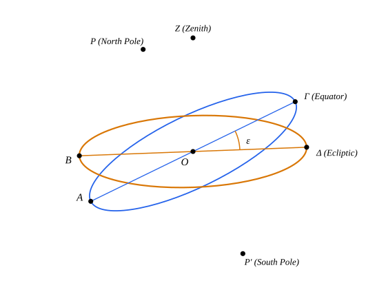

GEOMETOR • ptolemy
==================

**Visit the Online Archive:** https://geometor.github.io/ptolemy/

**Claudius Ptolemy • The Almagest, Planisphere • semantic digital archive**

Mission
-------

``geometor/ptolemy`` is part of the interconnected `GEOMETOR <https://geometor.com>`_ semantic digital archive. Claudius Ptolemy's landmark treatises established the foundations of ancient mathematical astronomy, chord trigonometry, cyclic quadrilaterals, spherical trigonometry, and stereographic projection. Within this archive, Ptolemy's geometric works are liberated from isolated print bounds into addressable semantic units, synchronized multi-track bilingual codices, calibrated vector diagrams, and exact symbolic algebra across the GEOMETOR corpus.

Books in This Archive
---------------------

- `The Almagest <https://geometor.github.io/ptolemy/almagest_geometry/>`_ — Book I of Ptolemy's *Syntaxis Mathematica* (c. 150 CE / ed. J. L. Heiberg, 1898), covering the sexagesimal chord table, golden pentagon-decagon construction, and Ptolemy's Theorem on cyclic quadrilaterals.
- `Planisphere <https://geometor.github.io/ptolemy/planisphaerium/>`_ — Astrolabe geometry and stereographic projection from the South Celestial Pole onto the equator (c. 150 CE / ed. Heiberg), preserving circles and establishing conformal coordinate systems.

Repository Contents
-------------------

- ``docsrc/`` — Multi-track Book Codex tracks, translation notes, and apparatus compiled by `PHOTON publish <https://github.com/photon-platform/publish>`_.
- ``resources/`` — Primary source Greek and Latin witness texts, citations, and figure registries.
- ``src/geometor/ptolemy/`` — Exact SymPy chord constructions, stereographic projection engine, and CLI tools.

Local Build & Verification
--------------------------

.. code-block:: bash

   publish build
   uv run --no-sync pytest

Part of the GEOMETOR Knowledge Archive
--------------------------------------

Explore all **74 Book Codices** and **11 Mathematical Catalogs** at https://geometor.com/books/.
