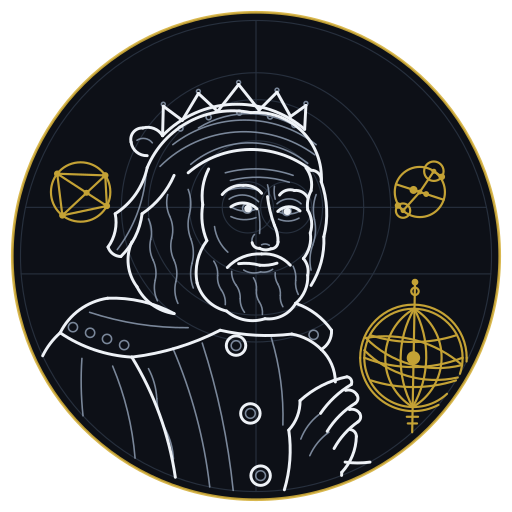

:site_title: Claudius Ptolemy

.. container:: author-overline

   semantic digital archive • the works of

================
Claudius Ptolemy
================

:person:`Claudius Ptolemy <ptolemy>` (c. 100 – c. 170 CE) forged the mathematical language of spherical astronomy, chord trigonometry, and conformal map projection in second-century Alexandria. This archive presents the geometric heart of his *Almagest* (Book I) alongside his *Planisphere*, pairing critical Greek and Latin witnesses with English translations, interactive figures, and exact SymPy chord constructions.

Works in This Archive
---------------------

.. container:: home-book-hero

   .. container:: home-book-thumb

      .. image:: _static/figures/fig01_celestial_sphere_preliminaries.svg
         :alt: Celestial sphere and oblique ecliptic from Almagest Book I
         :target: almagest_geometry/index.html

   .. container:: home-book-body

      .. rubric:: Heiberg Edition · 1898 · Syntaxis Mathematica Book I (Chs. 1–16)

      **The Almagest (*Μαθηματικὴ Σύνταξις*)** — Complete Book I from the philosophical preface and spherical cosmology through the sexagesimal Table of Chords (360 rows), Ptolemy's Theorem, planar and spherical Menelaus theorems, Table of Obliquity, and right-sphere ascensions.

      .. container:: home-actions

         * :doc:`Open The Almagest → <almagest_geometry/index>`
         * :doc:`Table of Chords (Ch. 10–11) → <almagest_geometry/ch_10/ch_10-en>`
         * :doc:`Spherical Trigonometry (Ch. 13) → <almagest_geometry/ch_13/ch_13-en>`

.. container:: home-book-hero no-thumb

   .. container:: home-book-body

      .. rubric:: Hermann of Carinthia 1143 & Heiberg 1907 · 20 Sections

      **Planisphere (*Planisphaerium*)** — Preserved through Hermann of Carinthia's twelfth-century Latin translation from Arabic, proving that stereographic projection from the South Celestial Pole onto the equatorial plane maps circles on the sphere to circles and lines in the plane—the mathematical basis of the astrolabe.

      .. container:: home-actions

         * :doc:`Open Planisphere → <planisphaerium/index>`
         * :doc:`Proposition 1 → <planisphaerium/prop_01/prop_01-en>`

Key Features
------------

.. container:: home-feature-grid

   .. container:: home-feature-card

      **Synchronized Greek & Latin Tracks**

      Compare English translations directly with Heiberg's Greek text of the *Almagest*, Hermann of Carinthia's Latin *Planisphaerium*, analytical **Summary** syntheses, and primary-source **Notes**.

   .. container:: home-feature-card

      **Exact Symbolic Chord Algebra**

      Inspect exact SymPy constructions of Ptolemy's :math:`36^\circ`/:math:`72^\circ` golden chords, the cyclic quadrilateral theorem, and stereographic circle inversions in :doc:`Symbolic Demos <demos/index>`.

   .. container:: home-feature-card

      **9 Calibrated Celestial & Planar Plates**

      Interactive SVG plates trace the celestial sphere, pentagon-decagon chord geometry, Menelaus's spherical theorem, and the astrolabe projection.

Reference & Project
-------------------

.. container:: home-columns

   .. container:: home-col

      .. rubric:: Scholarly Apparatus

      * :doc:`People <almagest_geometry/people/index>` — Ptolemy, Menelaus, Hipparchus, Hermann of Carinthia, and J. L. Heiberg
      * :doc:`Concordance <almagest_geometry/concordance>` & :doc:`Bibliography <almagest_geometry/bibliography>` — Heiberg folio pagination and critical sources
      * :doc:`Glossary <almagest_geometry/glossary>` — Key Greek and Latin trigonometric and astrolabe terms

   .. container:: home-col

      .. rubric:: About This Project

      * :doc:`About <about/index>` — Scope, sources, and connection to GEOMETOR
      * :doc:`Using This Edition <usage/index>` — Reading guide, track switching, and diagram controls
      * :doc:`Demos <demos/index>` & :doc:`Modules <modules/index>` — Executable Python demonstrations and API reference

.. toctree::
   :hidden:
   :maxdepth: 2

   almagest_geometry/index
   planisphaerium/index
   about/index
   usage/index
   demos/index
   modules/index
